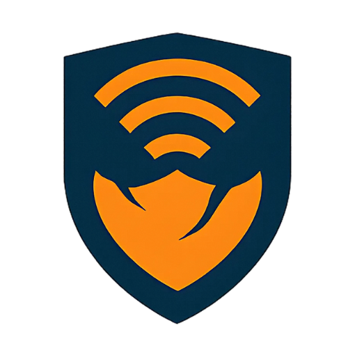
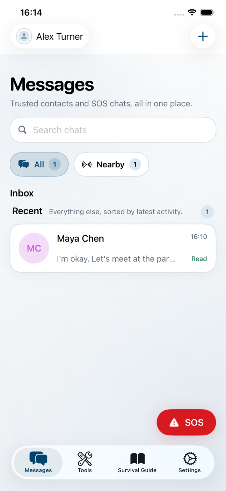
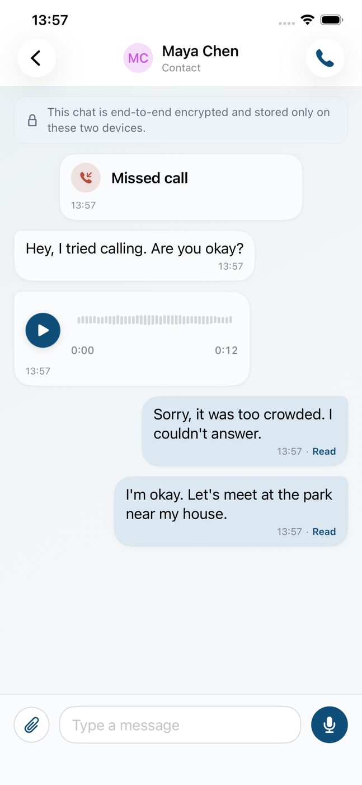
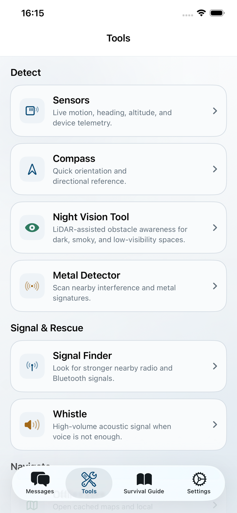
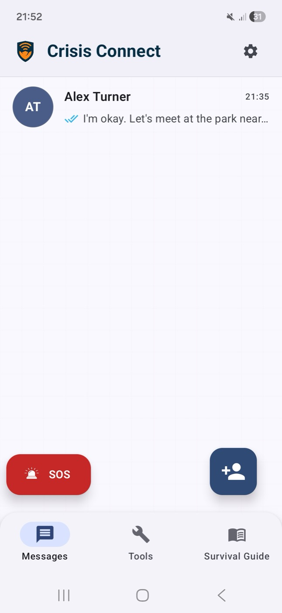
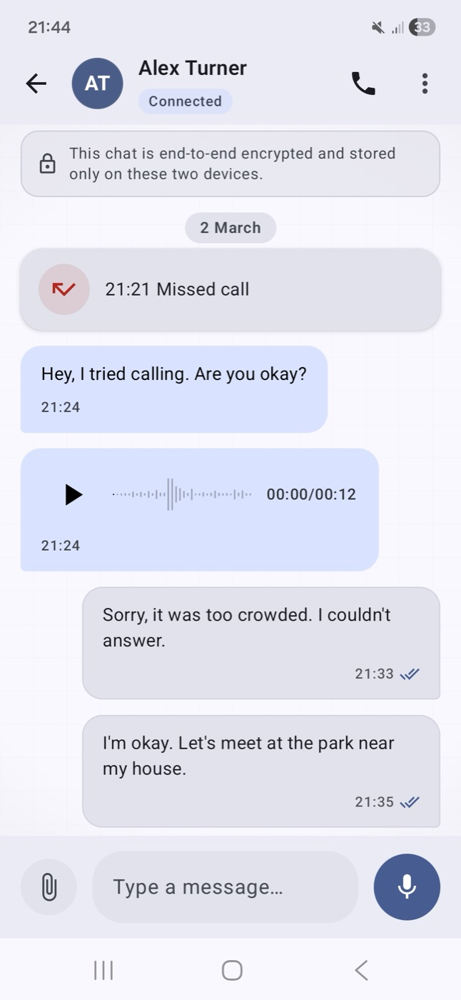
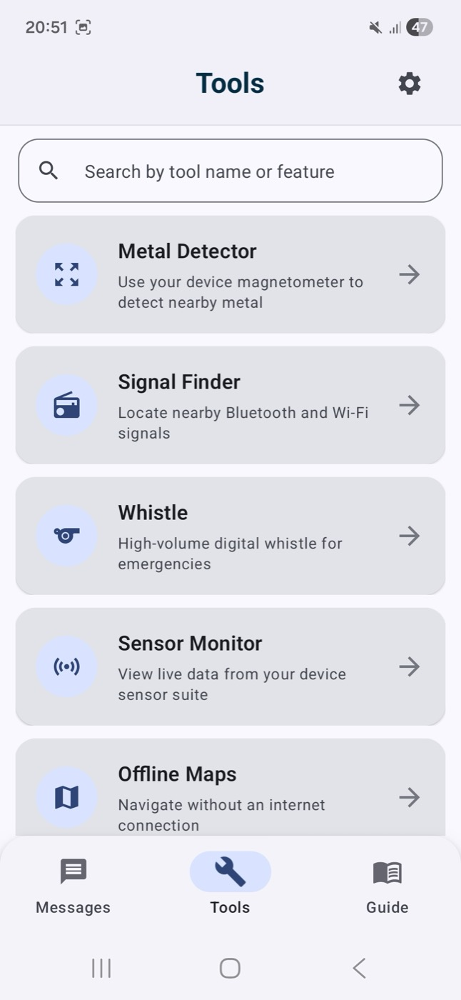
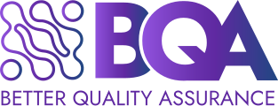

<p align="center">
  
</p>

<h1 align="center">Crisis Connect</h1>

<p align="center">
  <strong>When networks fail, we connect.</strong><br/><br/>
  Open-source, offline-first communication platform for disaster response.<br/>
  End-to-end encrypted messaging, voice and video calls, and rescue coordination.<br/>
  The Bluetooth layer needs no infrastructure at all. When a network is reachable,<br/>
  an end-to-end encrypted internet layer extends the same conversation.
</p>

<br/>

<p align="center">
  <a href="https://play.google.com/store/apps/details?id=com.auralis.crisisconnect"></a>&nbsp;&nbsp;
  <a href="https://apps.apple.com/app/crisis-connect/id6759731195"></a>&nbsp;&nbsp;
  <a href="https://github.com/emirhan-duman/Crisis-Connect/releases/download/v1.2.0-android.81/crisis-connect-1.2.0-81.apk"></a>&nbsp;&nbsp;
  <a href="https://crisisconnect.network"></a>
</p>

<p align="center">
  <a href="./LICENSE"></a>&nbsp;
  <a href="https://www.bestpractices.dev/projects/14600"></a>&nbsp;
  &nbsp;
  <a href="docs/releases/1.2.0.md"></a>&nbsp;
  &nbsp;
  &nbsp;
  <a href="#testing"></a>&nbsp;
  
</p>

<p align="center">
  <a href="https://x.com/CrisisConnectHQ"></a>&nbsp;
  <a href="https://www.instagram.com/crisisconnecthq/"></a>&nbsp;
  <a href="https://www.linkedin.com/company/112030175"></a>&nbsp;
  <a href="https://crisisconnect.com.tr"></a>
</p>

<p align="center">
  <a href="#how-it-works">How It Works</a>&nbsp;&nbsp;&bull;&nbsp;&nbsp;
  <a href="#screenshots">Screenshots</a>&nbsp;&nbsp;&bull;&nbsp;&nbsp;
  <a href="#features">Features</a>&nbsp;&nbsp;&bull;&nbsp;&nbsp;
  <a href="#security-model">Security</a>&nbsp;&nbsp;&bull;&nbsp;&nbsp;
  <a href="#architecture">Architecture</a>&nbsp;&nbsp;&bull;&nbsp;&nbsp;
  <a href="#getting-started">Get Started</a>&nbsp;&nbsp;&bull;&nbsp;&nbsp;
  <a href="https://github.com/emirhan-duman/Crisis-Connect/discussions">Discussions</a>
</p>

---

## Why Crisis Connect

When disaster strikes, communication infrastructure is the first thing to fail -- as seen after the 2023 Turkey-Syria earthquakes, Hurricane Maria, and the 2011 Japan earthquake. Existing offline tools either require specialized radio hardware most people do not carry, or silently assume internet backhaul.

Crisis Connect runs on the smartphone already in your pocket, works over **Bluetooth with zero infrastructure**, and encrypts everything end-to-end by default.

## How It Works

```
     ┌──────────┐         ┌──────────┐         ┌──────────┐
     │ Device A │◄──BLE──►│ Device B │◄──BLE──►│ Device C │
     └──────────┘         └──────────┘         └──────────┘
          │                     │                     │
          │   QR / SPAKE2       │   GATT Mesh Relay   │
          │   ECDH + AES-256    │   Multi-hop Forward │
          │                     │                     │
          ▼                     ▼                     ▼
     ┌─────────────────────────────────────────────────────┐
     │              All messages E2E encrypted             │
     │         Stored only on sender & receiver            │
     │            No server ever sees plaintext            │
     └─────────────────────────────────────────────────────┘
```

1. **Discovery** -- Automatic BLE advertising and scanning find nearby devices with no system pairing menu.
2. **Secure Channel** -- Offline key exchange via **QR ECDH (P-256)** or **SPAKE2 (RFC 9382)** short codes, with no server or CA.
3. **Dual Transport** -- Messages, voice, photos, and files travel over **BLE GATT multi-hop mesh** (plus cross-platform BLE Opus voice calls). When connectivity returns, the same conversations seamlessly continue over the **Signal Protocol (libsignal, PQXDH)** internet layer with store-and-forward queuing.

Neither layer depends on the other. The app is fully functional in airplane mode with Bluetooth enabled.

## Screenshots

<p align="center">
  &nbsp;&nbsp;
  &nbsp;&nbsp;
  
</p>

<p align="center">
  &nbsp;&nbsp;
  &nbsp;&nbsp;
  
</p>

<p align="center">
  <sub><strong>Top:</strong> iOS &nbsp;&bull;&nbsp; <strong>Bottom:</strong> Android &nbsp;|&nbsp; <strong>Left:</strong> Inbox & SOS broadcast &nbsp;&bull;&nbsp; <strong>Center:</strong> E2E encrypted chat & calls &nbsp;&bull;&nbsp; <strong>Right:</strong> Emergency toolkit</sub>
</p>

## Features

| Area | Capabilities |
|:--|:--|
| **Offline Communication (BLE)** | E2E encrypted text, voice messages, images, files, and offline map bundles over BLE GATT; multi-hop GATT mesh relay; **cross-platform Android ↔ iOS real-time Opus voice calls** (GATT `0xCD00` / RFCOMM); QR ECDH & SPAKE2 nearby pairing; background-resilient SOS broadcast; offline Agency Bridge. |
| **Internet Layer (Signal)** | **Signal Protocol (`libsignal`, PQXDH)** with Double Ratchet, anti-downgrade pinning, safety numbers, and TOFU warnings; 1:1 WebRTC voice/video calls with CallKit/Telecom & lock-screen ringing; screen sharing (ReplayKit on iOS); cross-platform encrypted attachments; agency channels & store-and-forward queuing. |
| **Crisis Sentinel (AI)** | On-device offline disaster assistant powered by **Google AI Edge LiteRT-LM** (one-time model download, zero-network inference) with offline disaster knowledge grounding, safety validation, offline map tool output, and an optional cloud engine. |
| **Rescue Operations** | Dedicated module for response teams (AFAD, Red Cross, field teams): **offline-verifiable ECDSA P-256 role certificates** (72h TTL, Play Integrity / App Attest gated), personnel check-ins with offline reply queueing, victim ↔ rescuer voice link, live GPS sharing, CrisisLink sync, agency-scoped Firestore rules, and Android dynamic feature delivery (`feature_rescue`). |
| **Emergency Toolkit** | MapLibre offline vector maps, sensor-fused compass, cellular/Wi-Fi/BLE signal finder, magnetometer metal detector, acoustic rescue whistle, breadcrumb trail, CPR assist, flashlight patterns, sensor dashboard, offline survival guides, plus iOS LiDAR obstacle scanner & night vision. |
| **System & Watch Integration** | One-tap SOS with 5-second arming countdown via Android Quick Settings tile / home widgets and iOS 18 Control Center / Action Button / WidgetKit / Live Activity, plus **Wear OS** and **Apple Watch** companion apps. |

## Security Model

Security is foundational to the design, assuming monitored networks and adversarial radios:

| Layer | Mechanism |
|:--|:--|
| **Offline BLE** | AES-256-GCM (Google Tink on Android, Apple CryptoKit on iOS) with ECDH / SPAKE2 + HKDF-SHA256 keys; mesh relays forward ciphertext only |
| **Internet Messaging** | Signal Protocol via [`libsignal`](https://github.com/signalapp/libsignal) (PQXDH + Double Ratchet + hardware-backed identity keys + anti-downgrade pinning) |
| **Rescue Identity** | Server-signed ECDSA P-256 role certificates (72h TTL), verifiable completely offline |
| **Local Storage** | SQLCipher encrypted Room DB + Android Keystore; Keychain / Secure Enclave on iOS |
| **API & Telemetry** | Firebase App Check (Play Integrity / App Attest) + Firestore Rules; analytics and Crashlytics are **opt-in** and disabled by default |

**Explicit boundaries (what is *not* E2E encrypted):** 1:1 internet calls use WebRTC **DTLS-SRTP** (transport-encrypted, not additionally E2EE above the media layer); SOS reports sent to agency dashboards are transport-encrypted so agencies can act on them; SFU group calls with MLS per-frame encryption exist as an experimental backend and are **not enabled** in released apps.

Read the full security documentation:
- **[Security Model & Privacy](docs/SECURITY_MODEL.md)** -- cryptography, key exchange, certificates, storage, and privacy controls
- **[Threat Model](docs/THREAT_MODEL.md)** -- trust boundaries, assets, attacker model, and abuse paths
- **[Secure Development Policy](docs/SECURE_DEVELOPMENT.md)** & **[External Interfaces](docs/EXTERNAL_INTERFACES.md)**
- **[Data Inventory & Retention](docs/DATA_INVENTORY_AND_RETENTION.md)** & **[Security Policy (Responsible Disclosure)](SECURITY.md)**

## Architecture

Crisis Connect is built natively in **Kotlin** (Jetpack Compose, Material 3, Android 7.0+ / Wear OS) and **Swift** (SwiftUI, iOS 17+ / watchOS 10+), backed by optional **Firebase** services (Auth, Firestore, Cloud Functions in TypeScript) that are **not required for offline messaging**.

- **[Architecture, Protocols & Codebase](docs/ARCHITECTURE.md)** -- repository layout, full tech stack, BLE framing & GATT mesh diagrams, Opus voice pipeline, backend services, build variants, and reproducible `tokei` codebase metrics (`300,874` first-party LOC across Android & iOS)
- **[Android Guide](Android/README.md)** · **[iOS Guide](iOS/README.md)** · **[Release Verification](docs/RELEASE_VERIFICATION.md)** · **[Incident Response](docs/INCIDENT_RESPONSE.md)**

### Testing

Public CI runs automatically on pull requests via GitHub Actions (see [Actions](https://github.com/emirhan-duman/Crisis-Connect/actions)):
- **[Android CI](.github/workflows/android-ci.yml):** Native frame fuzz smoke run (`-runs=10000`), `:app:lintDebug`, `:app:assembleDebug`, `:app:testDebugUnitTest`, `:feature_rescue:testDebugUnitTest` (uses `google-services.json.example`, no Firebase secrets required).
- **[iOS CI](.github/workflows/ios-ci.yml):** Project, scheme, test plan, package manifest, and Swift syntax validation (`iOS/Scripts/ci-validate.sh`). Full Xcode linking requires building the non-committed native `.xcframework` static libraries ([iOS/README.md](iOS/README.md)).
- **[Functions CI](.github/workflows/functions-ci.yml):** `npm ci`, dependency tree and audit checks, TypeScript build, unit/property tests, and Firestore rules emulator tests.

See **[docs/ARCHITECTURE.md#testing](docs/ARCHITECTURE.md#testing)** for local test commands and covered test areas.

## Getting Started

### Download the App

Install from Google Play or the App Store, or sideload the exact Google Play-signed universal Android APK for release `1.2.0` (`versionCode` `81`, Android 7.0+):

- **Direct APK:** [`crisis-connect-1.2.0-81.apk`](https://github.com/emirhan-duman/Crisis-Connect/releases/download/v1.2.0-android.81/crisis-connect-1.2.0-81.apk)
- **SHA-256:** `8c3bb5f85a0559bbf510e93f40162795f664d3ffa53d913663889d6e0986c3a7`
- **Verification:** Published with keyless Sigstore bundles, a CycloneDX SBOM, and GitHub artifact attestation -- see **[Release Verification](docs/RELEASE_VERIFICATION.md)** and the [`v1.2.0-android.81` release notes](https://github.com/emirhan-duman/Crisis-Connect/releases/tag/v1.2.0-android.81).

### Build From Source

| Platform | Requirements | Setup Guide |
|:--|:--|:--|
| **Android** | Android Studio Ladybug+ · JDK 21 · Android SDK 37 | [Android/README.md](Android/README.md) |
| **iOS** | Xcode 16+ · iOS 17+ · macOS Sequoia+ · Rust toolchain | [iOS/README.md](iOS/README.md) |
| **Backend** | Node.js 22 · Firebase CLI · Firebase project | `Android/functions/` |

> **Note:** BLE features require a **physical device**. Simulators and emulators do not support Bluetooth.

```bash
# Quick start: Android debug build & unit tests
git clone https://github.com/emirhan-duman/Crisis-Connect.git
cd Crisis-Connect/Android
cp app/google-services.json.example app/google-services.json
cp local.properties.example local.properties
./gradlew :app:assembleDebug :app:testDebugUnitTest
```

For full Firebase configuration (`google-services.json`, `GoogleService-Info.plist`, `local.properties`, Firestore rules & Functions deployment) and rebuilding vendored iOS `.xcframework` libraries, see **[Android/README.md](Android/README.md)** and **[iOS/README.md](iOS/README.md)**.

## Permissions

Every permission maps to a specific user-facing capability and is requested at runtime. **The app works with only Bluetooth permission granted** -- all others are optional:

| Permission | Why It's Needed |
|:--|:--|
| **Bluetooth** (scan, advertise, connect) | Core P2P messaging and device discovery |
| **Camera** | QR code scanning, video calls |
| **Microphone** | Voice calls and voice message recording |
| **Location** | Offline maps centering, location sharing, rescue live location |
| **Internet** | Internet messaging and calls, auth, rescue sync, opt-in diagnostics |
| **Notifications** | Message, call, check-in, and SOS notifications |
| **Foreground Service** | Maintaining BLE connections, active calls, and SOS broadcasts |
| **Sensors** | Compass, metal detector, sensor dashboard |
| **Wi-Fi State** | Signal finder tool |

## Localization

Crisis Connect ships in **19 languages** across UI, Survival Guide, and field tools:
Arabic · Bengali · Chinese (Simplified) · English · Filipino · French · German · Hindi · Indonesian · Japanese · Kurdish · Persian · Portuguese · Russian · Spanish · Turkish · Ukrainian · Urdu · Vietnamese

[](https://hosted.weblate.org/engage/crisis-connect/)

Community translations are hosted on **[Hosted Weblate](https://hosted.weblate.org/projects/crisis-connect/)** under the repository's [AGPL-3.0](./LICENSE) license. See **[docs/LOCALIZATION.md](docs/LOCALIZATION.md)** for guidelines and validation steps.

## Contributing & Roadmap

Contributions from developers, security researchers, testers, and translators are welcome:
- Read **[CONTRIBUTING.md](CONTRIBUTING.md)** and **[CODE_OF_CONDUCT.md](CODE_OF_CONDUCT.md)**
- Browse open **[Issues](https://github.com/emirhan-duman/Crisis-Connect/issues)** or start a conversation in **[GitHub Discussions](https://github.com/emirhan-duman/Crisis-Connect/discussions)**
- Report security issues privately per **[SECURITY.md](SECURITY.md)**

### Roadmap

- **Shipped (`v1.2.0`):** Offline BLE GATT mesh, cross-platform BLE Opus voice calls, QR ECDH & SPAKE2 pairing, Signal Protocol (PQXDH) internet layer, 1:1 WebRTC calls + screen sharing, Crisis Sentinel offline LLM, ECDSA rescue role certs, personnel check-ins, Wear OS & Apple Watch companions, 19 languages, published on Google Play & App Store. See **[docs/releases/1.2.0.md](docs/releases/1.2.0.md)** and **[CHANGELOG.md](CHANGELOG.md)**.
- **In Progress:** Experimental SFU group calls with MLS per-frame encryption (in repo, not enabled in released builds), BLE protocol specification docs, expanded BLE edge-case test coverage.
- **Planned:** Multi-party group mesh chat over BLE GATT, offline map region sharing over BLE, Wi-Fi Direct transport on Android, WCAG accessibility audit, Architecture Decision Records (ADRs).

## Links

| | | | |
|:--|:--|:--|:--|
| **Website** | [crisisconnect.network](https://crisisconnect.network) | **X (Twitter)** | [@CrisisConnectHQ](https://x.com/CrisisConnectHQ) |
| **Website (TR)** | [crisisconnect.com.tr](https://crisisconnect.com.tr) | **Instagram** | [@crisisconnecthq](https://www.instagram.com/crisisconnecthq/) |
| **Google Play** | [Download for Android](https://play.google.com/store/apps/details?id=com.auralis.crisisconnect) | **LinkedIn** | [Crisis Connect](https://www.linkedin.com/company/112030175) |
| **Android APK** | [Play-signed 1.2.0 universal APK](https://github.com/emirhan-duman/Crisis-Connect/releases/download/v1.2.0-android.81/crisis-connect-1.2.0-81.apk) | **Discussions** | [GitHub Discussions](https://github.com/emirhan-duman/Crisis-Connect/discussions) |
| **App Store** | [Download for iOS](https://apps.apple.com/app/crisis-connect/id6759731195) | **Source Code** | [github.com/emirhan-duman/Crisis-Connect](https://github.com/emirhan-duman/Crisis-Connect) |

## Supported by

<a href="https://codemagic.io/">
  <picture>
    <source media="(prefers-color-scheme: dark)" srcset="https://codemagic.io/media/landing/press-kit/svg/logo-white.svg" />
    <source media="(prefers-color-scheme: light)" srcset="https://codemagic.io/media/landing/press-kit/svg/logo-blue.svg" />
    
  </picture>
</a>

Codemagic supports Crisis Connect with free native Android and iOS CI builds through its non-profit program.

<p>
  <a href="https://clemta.com/">
    <picture>
      <source media="(prefers-color-scheme: dark)" srcset="docs/supporters/clemta-dark.svg" />
      <source media="(prefers-color-scheme: light)" srcset="docs/supporters/clemta-light.svg" />
      
    </picture>
  </a>
</p>

Clemta supports Crisis Connect by covering U.S. company formation and incorporation fees.

<p>
  <a href="https://www.browserstack.com/open-source">
    <picture>
      <source media="(prefers-color-scheme: dark)" srcset="docs/supporters/browserstack-dark.svg" />
      <source media="(prefers-color-scheme: light)" srcset="docs/supporters/browserstack-light.svg" />
      
    </picture>
  </a>
</p>

BrowserStack supports Crisis Connect through its Open Source Program with sponsored **Live, Automate, App Live, App Automate, and Percy** access (active through 19 October 2027) for mobile app testing, browser compatibility, web automation, and visual regression testing.

BrowserStack's required README verification statement: **This project is tested with BrowserStack.**

<p>
  <a href="https://hosted.weblate.org/engage/crisis-connect/">
    <picture>
      <source media="(prefers-color-scheme: dark)" srcset="docs/supporters/weblate-dark.svg" />
      <source media="(prefers-color-scheme: light)" srcset="docs/supporters/weblate-light.svg" />
      
    </picture>
  </a>
</p>

Hosted Weblate supports Crisis Connect with free translation hosting through its Libre plan for open-source projects, helping the community translate and review the Android and iOS apps.

<p>
  <a href="https://betterqa.co/">
    <picture>
      <source media="(prefers-color-scheme: dark)" srcset="docs/supporters/betterqa-dark.png" />
      <source media="(prefers-color-scheme: light)" srcset="docs/supporters/betterqa.svg" />
      
    </picture>
  </a>
</p>

BetterQA supports Crisis Connect with a complimentary security assessment of the Android and iOS apps, including automated scanning, engineer validation of findings, remediation guidance, and one retest. The assessment has been agreed; results are pending.

<p>
  <a href="https://backbox.dev/">
    <picture>
      <source media="(prefers-color-scheme: dark)" srcset="docs/supporters/backbox-dark.png" />
      <source media="(prefers-color-scheme: light)" srcset="docs/supporters/backbox-light.png" />
      
    </picture>
  </a>
</p>

BackBox AI supports Crisis Connect with open-source security reviews and security analysis through the BackBox open-source partnership program.

## License

This project is licensed under the [GNU Affero General Public License v3.0](./LICENSE).

You are free to use, modify, and distribute this software. Any modified version made available over a network must also be open-sourced under the same license.

Crisis Connect vendors [libsignal](https://github.com/signalapp/libsignal) (AGPL-3.0-only) under `iOS/Packages/LibSignalClient` and consumes it as a Maven dependency on Android.

---

<p align="center">
  <strong>Built for resilience. Designed for crisis. Open for everyone.</strong><br/><br/>
  <sub>300,000 lines of first-party code across Android and iOS,<br/>19 spoken languages, 2 platforms, 1 mission: keeping people connected when it matters most.</sub>
</p>
